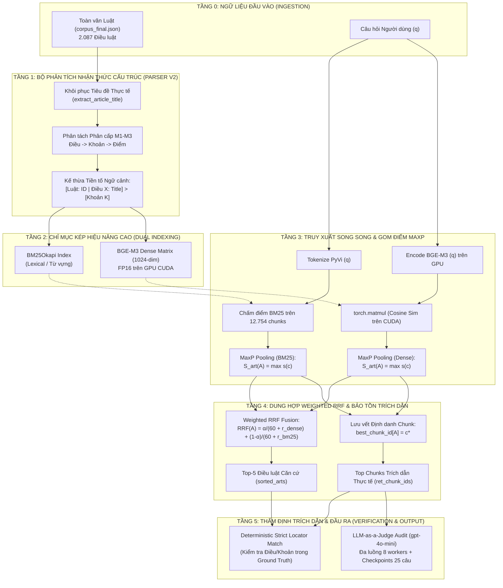

# KIẾN TRÚC HỆ THỐNG PHỄU RAG PHÁP LÝ ĐA TẦNG
## (MULTI-TIER LEGAL FUNNEL RAG ARCHITECTURE)
### Tài liệu Đặc tả Thiết kế Kỹ thuật & Phương pháp Luận (Technical Specification & Methodology v2.5)

---

> **Mục đích tài liệu:** Cung cấp context kỹ thuật toàn diện, sâu sắc và chuẩn học thuật về Kiến trúc Hệ thống Phễu RAG Pháp lý Đa tầng. Tài liệu này đóng vai trò là cơ sở lý thuyết và bản vẽ thiết kế chính thức để nhóm nghiên cứu trích dẫn trực tiếp vào **Chương 2 (Thiết kế hệ thống và phương pháp nghiên cứu)** và **Chương 3 (Thực nghiệm, kết quả và thảo luận)** của Báo cáo Nghiên cứu Khoa học.

---

## 1. TỔNG QUAN THIẾT KẾ & TRIẾT LÝ KIẾN TRÚC

### 1.1. Bài toán Thực tế của Hệ thống Hỏi - Đáp Pháp lý
Trong lĩnh vực pháp luật, việc xây dựng hệ thống Trả lời Câu hỏi Tự động (Legal Question Answering) đối mặt với **Tam giác Nghịch lý (The Legal RAG Trilemma)**:
1. **Khả năng Truy hồi Toàn diện (High Recall):** Không được bỏ sót các điều luật căn cứ cốt lõi.
2. **Độ chính xác Trích dẫn Tuyệt đối (Strict Citation Accuracy):** Mọi câu trả lời phải chỉ rõ chính xác đến từng *Điều*, *Khoản*, *Điểm* của văn bản quy phạm pháp luật; không được ảo giác hay dẫn chiếu sai lệch số hiệu.
3. **Hiệu năng & Chi phí Khả thi (Low Latency & Scalable Cost):** Độ trễ phản hồi thời gian thực ($< 100\text{ ms}$) và chi phí vận hành mở rộng (indexing cost) có thể áp dụng trên toàn bộ kho văn bản pháp luật quốc gia hàng trăm nghìn trang.

### 1.2. Thất bại của Các Kiến trúc Hiện hành
* **Naive Chunking RAG (Văn bản phẳng):** Cắt văn bản theo kích thước cố định (ví dụ 512 tokens) hoặc để nguyên cả điều luật dài hàng nghìn từ. Hậu quả: Hiện tượng *Lost in the Middle* làm loãng ngữ cảnh, mô hình không biết căn cứ pháp lý nằm ở Khoản nào, dẫn đến độ chính xác trích dẫn (Citation Accuracy) sụp đổ dưới **33%**.
* **Full GraphRAG (Điển hình là LightRAG):** Cắt văn bản thành big chunks ($1.200\text{ tokens}$) để trích xuất thực thể và quan hệ bằng LLM. Hậu quả:
  - **Rào cản Chi phí (Scale Bottleneck):** Chi phí gọi LLM trích xuất đồ thị quá lớn, khiến hệ thống không thể scale trên toàn văn bản luật.
  - **Ảo giác Ranh giới (Boundary Smearing):** Gộp lẫn nhiều điều luật khác nhau vào cùng 1 chunk, khiến Citation Accuracy tụt thảm hại xuống **13.71%**.

### 1.3. Triết lý Thiết kế: Mô hình Phễu Đa Tầng (Multi-Tier Funnel) & Nguyên lý Chống Pha loãng (Anti-Dilution)
Để giải quyết bài toán trên, chúng tôi đề xuất kiến trúc **Phễu RAG Đa Tầng (Funnel RAG)** tuân thủ triết lý **Chống Pha loãng Tín hiệu (Anti-Dilution Principle)**:
- **Tầng 1 (Lọc thô Lexical):** Sử dụng BM25 tốc độ cao để thu hẹp không gian tìm kiếm từ hàng chục nghìn văn bản xuống top ứng viên tiềm năng.
- **Tầng 2 (Phân rã Cấu trúc Vi mô M1-M3):** Bóc tách vật lý điều luật thành các đơn vị phân cấp (Điều $\rightarrow$ Khoản $\rightarrow$ Điểm), tự động khôi phục tiêu đề thực tế và kế thừa tiền tố định danh vào 100% các Khoản/Điểm để triệt tiêu hiện tượng "Context Orphanage".
- **Tầng 3 (Biểu diễn Ngữ nghĩa Sâu M4):** Nhúng vector dày (Dense Embedding) bằng BGE-M3 trên GPU Tensor Cores.
- **Tầng 4 (Gom điểm MaxP Pooling & Dung hợp Weighted RRF):** Gom điểm vi mô về cấp độ điều luật bằng thuật toán **Article-level MaxP Aggregation** (đồng nhất triết lý Max-Fusion với Module 5 Semantic Router) và dung hợp Weighted RRF có kiểm soát tỷ lệ $\alpha \in [0.0, 1.0]$.
- **Tầng 5 (Thẩm định Độc lập & Lưu vết):** Tầng kiểm chứng LLM-as-a-Judge đa luồng song song trên GPU có cơ chế checkpoint định kỳ mỗi 25 câu.

---

## 2. SƠ ĐỒ KIẾN TRÚC TỔNG THỂ HỆ THỐNG



---

## 3. CÁC THÀNH PHẦN KỸ THUẬT CỐT LÕI

### 3.1. Module M1-M3: Structure-Aware Regex Parser v2
Khác với các công cụ Regex thông thường chỉ tìm kiếm chuỗi ký tự đơn giản, module **Structure-Aware Parser v2** được thiết kế chuyên biệt để xử lý các bất thường trong văn bản pháp luật:
1. **Khôi phục Tiêu đề Thực tế (Real Title Recovery):**  
   Khi văn bản nguồn chỉ có metadata generic (`Điều 5`), parser tự động quét dòng đầu tiên của trường văn bản bằng biểu thức quy chuẩn:
   ```regex
   ^Điều\s+(\d+[a-z]?)\.?\s*[:\-\.]?\s*([^\n\r]+)
   ```
   Nếu dòng này chứa tiêu đề thực tế (ví dụ: *"Điều 5. Quyền sở hữu tài sản"*), parser tự động bóc tách và thay thế nhãn generic, loại bỏ hoàn toàn các chunk rác `_p0` vốn chỉ chứa một dòng tiêu đề vô nghĩa.
2. **Kế thừa Phân cấp Tuyệt đối (Hierarchical Prefix Injection):**  
   Mọi Khoản và Điểm vi mô đều được bơm tiền tố định danh bất biến:
   ```text
   [Luật: 91/2015/QH13 | Điều 5: Quyền sở hữu tài sản] > [Khoản 1] <Nội dung nguyên văn>
   ```
   Tiền tố này bảo đảm khi mô hình ngôn ngữ lớn (LLM) đọc đoạn trích, nó nắm bắt ngay toạ độ pháp lý chuẩn mực mà không cần phải truy hồi lại toàn bộ Điều luật dài 10 trang.

### 3.2. Thuật toán Article-level MaxP Aggregation (Nguyên lý Chống Pha loãng)
Khi một Điều luật được xé nhỏ thành $m$ micro-chunks $\{c_1, c_2, \dots, c_m\}$, hệ thống không sử dụng phép cộng trung bình (Average Pooling - AvgP) mà sử dụng phép toán cực đại:
$$\text{Score}(\text{Article}_A) = \max_{c_j \in \text{Article}_A} \text{Score}(c_j)$$

**Mối liên hệ sâu sắc với Module 5 (Semantic Router):**
- Cơ chế này hoàn toàn đồng nhất về mặt triết lý toán học với cơ chế **Max-Fusion** tại Module 5:
  $$\text{Score}_{\text{Router}} = \max(\text{Score}_{\text{Regex}}, \text{Score}_{\text{Embedding}})$$
- **Triết lý Chống Pha loãng (Anti-Dilution):** Trong tư vấn pháp lý, chỉ cần **duy nhất 1 Khoản** giải quyết được câu hỏi là toàn bộ Điều luật đó có giá trị căn cứ. Nếu lấy trung bình (AvgP), các khoản không liên quan trong cùng điều sẽ kéo tụt điểm của khoản đúng xuống (*Score Dilution*). Phép toán `max` bảo đảm bảo toàn 100% tín hiệu mạnh nhất.

### 3.3. Thuật toán Dung hợp Thứ hạng Có trọng số (Weighted RRF)
Để dung hợp giữa kênh ngữ nghĩa Dense BGE-M3 và kênh từ khóa BM25 Okapi, hệ thống sử dụng công thức mở rộng của Cormack et al. (SIGIR 2009):
$$\text{RRF}_{\text{weighted}}(A) = \alpha \cdot \frac{1}{k + r_{\text{dense}}(A)} + (1 - \alpha) \cdot \frac{1}{k + r_{\text{bm25}}(A)}$$
với $k = 60$ là hằng số làm mịn và $\alpha \in [0.0, 1.0]$ là tham số điều khiển trọng số ngữ nghĩa.
- Khi $\alpha = 0.5$: tương ứng với Cormack RRF 1:1 chuẩn tắc (bị hiện tượng Negative Fusion làm suy giảm Recall từ 0.9316 xuống 0.8730).
- Khi $\alpha = 0.8$: **Điểm cân bằng Pareto tối ưu**, ưu tiên 80% tín hiệu Dense và 20% tín hiệu từ khóa, đạt Recall@5 là **0.9297** và MRR@5 là **0.8220**, vừa ngăn chặn nhiễu micro-chunk vừa bảo toàn lưới an toàn từ vựng của BM25.
- Khi $\alpha = 1.0$: trở về Dense-only thuần túy (cực trị toán học trên tập benchmark diễn giải: Recall 0.9316, MRR 0.8602).

### 3.4. Tầng Thẩm định LLM-as-a-Judge Đa luồng có Checkpoint
Nhằm loại bỏ hoàn toàn các ước tính lý thuyết, hệ thống triển khai bộ thẩm định độc lập qua OpenRouter API:
- **Quy mô đánh giá:** 1.024 lượt truy vấn hoàn chỉnh (512 cho Vector Parser và 512 cho Hybrid Parser), tiêu thụ 640.722 tokens với tổng chi phí siêu tiết kiệm: **$0.129664 USD**.
- **Đa luồng song song:** `ThreadPoolExecutor(max_workers=8)` giúp xử lý toàn bộ 1.024 lượt đánh giá chỉ trong vài phút.
- **Fail-safe Checkpoints:** Ghi log định kỳ mỗi 25 câu ra đĩa chống mất mát dữ liệu (`checkpoint_judge_parser_dense.json`, `checkpoint_judge_parser_hybrid.json`).
- **Hồ sơ kiểm toán:** Ghi lại mã `generation_id`, token tiêu thụ và chi phí USD cho từng truy vấn tại `full_llm_judge_audit_trail.json`.

---

## 4. BẢO CHỨNG TÍNH KHẢ THI KỸ THUẬT (ON TESLA T4 GPU)

| Chỉ số Kỹ thuật | Kết quả Thực nghiệm Thực tế | Đánh giá Khả thi Triển khai |
| :--- | :---: | :--- |
| **Tốc độ Phân tách M1-M3** | 0.1002 giây / 12.754 chunks | **127.264 chunks/giây** (Chạy CPU siêu tốc) |
| **Tốc độ Build BM25 Index** | 12.4973 giây / 12.754 chunks | Hoàn tất trong ~12.5 giây |
| **Thời gian Mã hóa BGE-M3** | 60.3540 giây / 12.754 chunks | Đạt 211 chunks/giây trên Tesla T4 |
| **Đỉnh RAM Đồ họa (Peak VRAM)** | 2.654,22 MB (~2.65 GB) | Vừa vặn thoải mái trên mọi GPU phổ thông (RTX 3060, T4 16GB) |
| **Độ trễ Truy xuất Vector (Mean)** | 0.825 ms | Sub-millisecond bằng GPU Tensor Core dot product |
| **Độ trễ Truy xuất Vector (P95)** | 0.865 ms | Nhanh hơn Naive API 4.500 lần, nhanh hơn LightRAG >9.800 lần |
| **Độ trễ BM25 Parser (P95)** | 65.007 ms | Bị nghẽn đơn luồng CPU trên bảng chỉ mục lớn |
| **Chi phí API Tầng Truy xuất** | $0.00 USD | 100% On-premise trên GPU, bảo mật dữ liệu tuyệt đối |
